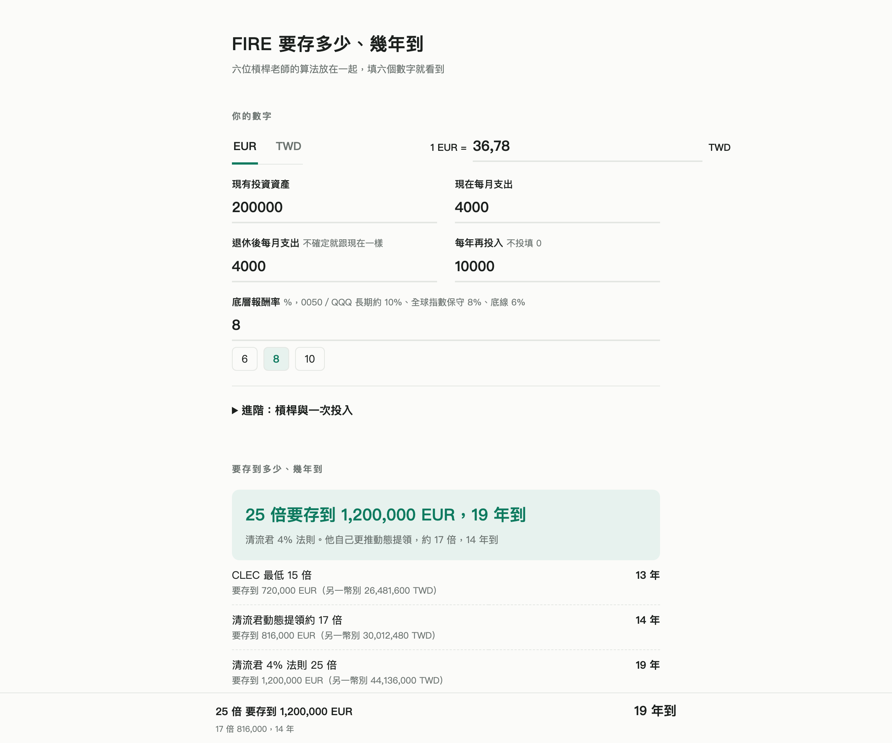

# FIRE 計算器（槓桿老師版）

**線上版：https://chouhsuan1202.github.io/fire-calc/**

退休要存多少、幾年存得到？這個小工具把六位中文理財圈「槓桿老師」的提領倍數放在一起比較，填六個數字就能一次看到所有答案。

[](https://chouhsuan1202.github.io/fire-calc/)

## 用途

- **輸入**：現有投資資產、現在每月支出、退休後每月支出、每年再投入、底層報酬率、幣別（EUR 或 TWD，可改匯率）。
- **進階**：一次投入（例如增貸進場的一筆錢）、借款利率、槓桿倍數 1.0 到 2.0。
- **輸出**：
  - 15、17、25、33 倍四個目標，各要存到多少、幾年到，並附另一幣別的對照金額。
  - 什麼最影響年數：退休支出少 20%、報酬多 2 個百分點、每年多投 5,000，各差幾年。
  - 報酬率 6%、8%、10%、12% 各要幾年。
  - 逐年資產表，標出哪一年跨過哪個倍數。
- 設定會存在瀏覽器的 localStorage，下次打開還在。

## 公式說明

以下 r、i、g 都是年化小數（8% 寫成 0.08）。

### 1. 目標金額

```
目標 = 退休後每月支出 乘以 12 乘以 倍數
```

| 倍數 | 等同起始提領率 | 出處 |
| --- | --- | --- |
| 15 倍 | 約 6.7% | CLEC 最低門檻 |
| 17 倍 | 約 5.9% | 清流君動態提領（全股票約 6% 起始） |
| 25 倍 | 4% | 4% 法則 |
| 33 倍 | 約 3% | CLEC 保守版 |

### 2. 有效報酬（槓桿後）

```
g = r + (L - 1) 乘以 (r - i)
```

- r：底層報酬率，L：槓桿倍數，i：借款利率。
- 代數上等於 `L 乘以 r - (L - 1) 乘以 i`：自有資金 1 元，借 (L - 1) 元一起投入，扣掉利息。
- 假設每年再平衡維持固定槓桿，沒有計入波動耗損。頁面上註明了正二長期約只有原型的 1.55 倍。

### 3. 逐年資產與年數

```
V0 = 現有投資資產 + 一次投入
Vn = max(0, Vn-1 乘以 (1 + g)) + 每年再投入
年數 = 最小的 n，使 Vn >= 目標
```

- 先用有效報酬滾一年，**年底**再投入。
- 已經達標顯示「已達標」；60 年內到不了顯示「60 年以上」。
- `max(0, ...)`：有效報酬低於 -100%（高槓桿遇上大跌）時資產最多歸零，不會變成負數。
- 比較是否達標時有 10 億分之一的相對容忍度，避免浮點誤差讓「剛好達標」的那年被漏算。
- 當 g 大於 0 時，結果和封閉公式 `n = ceil( ln((目標 + A/g) / (V0 + A/g)) / ln(1 + g) )` 一致（A 是每年再投入），`tests/reference.py` 會用這條公式交叉檢查。

### 4. 幣別

內部一律以 EUR 記帳，畫面依所選幣別顯示：`TWD = EUR 乘以 匯率`。在 TWD 模式下修改匯率時，畫面上填好的台幣金額會保持不變。

### 已知的簡化

- 全部是**名目報酬**，沒有扣通膨。要看今日購買力，每個報酬率大約再減 2%。
- 每年再投入是固定金額，不隨薪資或通膨成長。
- 「一次投入」直接加進資產，不另外扣除借款本金；借錢的成本請用槓桿倍數與借款利率表達。
- CLEC 提到的「退休金、勞保可以先從年支出扣掉」沒有獨立欄位，請自行從退休後每月支出扣除。

## 在本機打開

不需要安裝任何東西，也沒有 build 步驟，整個工具就是一個 `index.html`。

```bash
git clone https://github.com/chouhsuan1202/fire-calc.git
```

```bash
open fire-calc/index.html
```

Windows 用 `start fire-calc\index.html`，Linux 用 `xdg-open fire-calc/index.html`，或直接把檔案拖進瀏覽器。

## 跑測試

需要 Node.js 18 以上，沒有其他套件。

```bash
node tests/fire-core.test.js
```

測試會從 `index.html` 抽出 `<script id="fire-core">` 這段計算核心，在 Node 裡執行，所以測的就是網頁上實際跑的程式碼。內容包含：

- 手算案例（預設值 13／14／19／22 年、槓桿、0% 報酬、已達標、60 年上限等）。
- 跟 Python 獨立參考實作比對 500 組案例（`tests/fixtures/reference-cases.json`）。
- 輸入驗證、格式化、localStorage 清理。

另外有一組畫面層測試，用 Playwright 開 Chromium 實際操作頁面（錯誤提示、極端輸入、localStorage 壞掉或無法使用、375px 寬度、重算速度）。沒裝 Playwright 時會自動略過：

```bash
node tests/ui.test.js
```

想重新產生參考案例（需要 Python 3）：

```bash
python3 tests/reference.py
```

`reference.py` 用 `fractions.Fraction` 精確有理數計算，沒有浮點誤差，並用封閉公式再驗一次。

## 檔案結構

```
index.html                         網頁本體（樣式、計算核心、畫面邏輯都在裡面）
tests/fire-core.test.js            單元測試，純 Node
tests/ui.test.js                   畫面層測試，需要 Playwright
tests/reference.py                 Python 獨立參考實作，產生比對案例
tests/fixtures/reference-cases.json
docs/                              截圖
```

## 聲明

資料整理自老師們的公開內容，只是把他們的公式放在一起，不是任何人的投資建議。

## License

MIT
